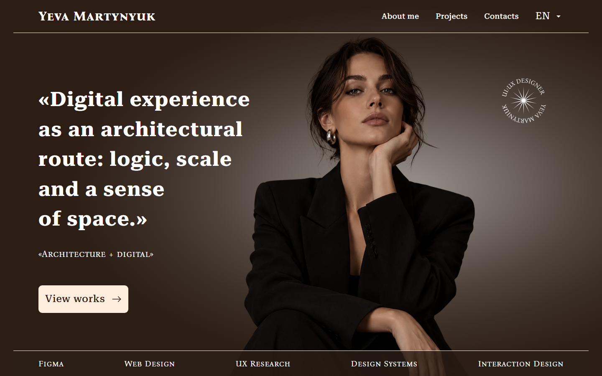

# Yeva Martynyuk — портфоліо

Двомовне (🇺🇦 / 🇬🇧) сайт-портфоліо UI/UX-дизайнерки на межі архітектури й діджитал. Створене для пошуку стажування в студіях, що поєднують архітектуру та цифрові продукти.

**🔗 Живий сайт:** [portfolio-new-test-six.vercel.app](https://portfolio-new-test-six.vercel.app)



## Ідея

> «Цифровий досвід як архітектурний маршрут: логіка, масштаб і відчуття простору.»

Користувацький шлях проєктується так, як архітектор проєктує рух будівлею: з входом, поворотами, паузами й зрозумілим виходом. Перший екран одразу показує, хто це, як вона мислить, і веде до робіт. Детальний план сайту: [docs/plan.md](docs/plan.md).

## Що вже є

- Перший екран за макетом у Figma: навігація, заголовок, кнопка «View works», бейдж «UI/UX Designer», панель навичок.
- Перемикач мови UA / EN. Мова запам'ятовується в браузері, а першого разу визначається за мовою системи.
- Адаптивна сітка на 12 колонок (десктоп) і 4 колонки (планшет, мобільний). Пристрої ≤900px мають окрему композицію: фото над текстом з плавним переходом у фон.
- Мета-дані сторінки та атрибут `lang` змінюються разом із мовою.

## Технології

| Що | Для чого |
| --- | --- |
| [React 19](https://react.dev) | інтерфейс |
| [TypeScript](https://www.typescriptlang.org) | типізація |
| [Vite](https://vite.dev) | збірка та dev-сервер |
| CSS (без фреймворків) | сітка, адаптивність, градієнти |
| [Oxlint](https://oxc.rs) | лінтинг |
| Google Fonts: Bona Nova SC, Roboto Serif | типографіка (з кирилицею) |
| [Figma](https://www.figma.com) | макет |
| [Vercel](https://vercel.com) | хостинг |

## Запуск локально

Потрібен Node.js 22 або новіший.

```bash
npm install
npm run dev
```

Сайт відкриється на `http://localhost:5173`.

Інші команди:

```bash
npm run build    # перевірка типів і production-збірка у dist/
npm run preview  # локальний перегляд збірки
npm run lint     # лінтинг
```

## Структура

```
src/
  App.tsx      # сторінка та перемикач мови
  App.css      # розкладка, сітка, адаптивність
  i18n.ts      # тексти UA / EN
  index.css    # змінні, шрифти, базові стилі
  assets/      # фото, іконки
docs/
  plan.md      # план сайту й позиціонування
```
